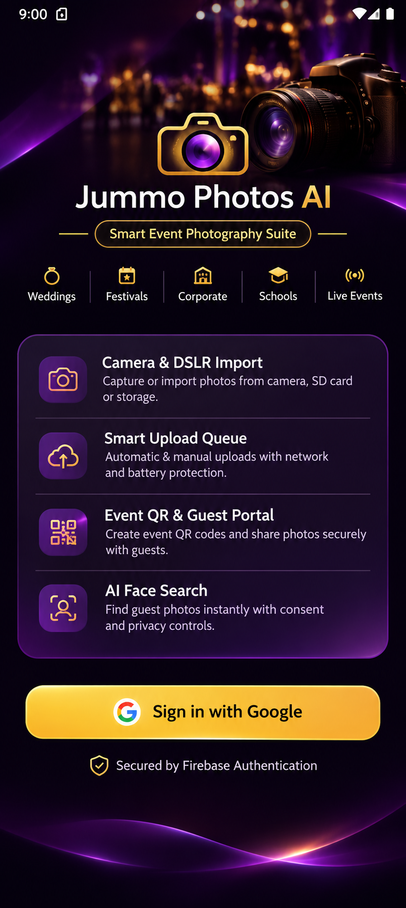
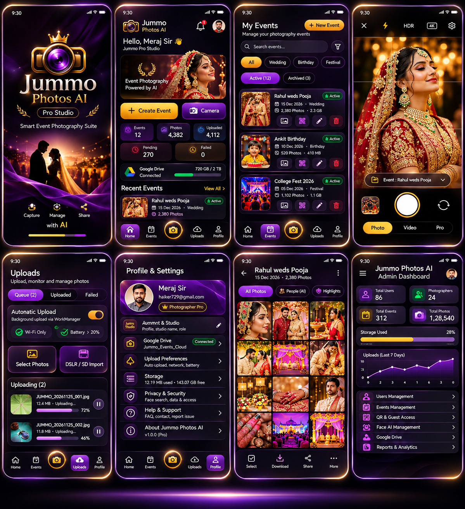

<div align="center">


# Jummo Photos AI
**Smart Event Photography Suite for Android**

[](https://github.com/haiker729-sys/Photo-/actions/workflows/android-apk-build.yml)
[](https://github.com/haiker729-sys/Photo-/releases/latest)
[](https://haiker729-sys.github.io/Photo-/)
[-22C55E?logo=android)](https://github.com/haiker729-sys/Photo-/releases)
[](gradle/libs.versions.toml)

<p align="center">
  <a href="https://haiker729-sys.github.io/Photo-/"><strong>Official Website</strong></a> •
  <a href="https://github.com/haiker729-sys/Photo-/releases/latest"><strong>Download Latest APK</strong></a> •
  <a href="https://github.com/haiker729-sys/Photo-/releases"><strong>All Releases</strong></a> •
  <a href="https://github.com/haiker729-sys/Photo-/actions/workflows/android-apk-build.yml"><strong>CI/CD Build Logs</strong></a>
</p>

</div>

---

## 1. Introduction

**Jummo Photos AI** is an Android event photography management application built with **Kotlin**, **Jetpack Compose (Material Design 3)**, **CameraX**, **WorkManager**, and **Firebase (Authentication & Cloud Firestore)**. It provides photographers with a unified mobile workspace to organize events, capture photos on-location, import DSLR and SD card files, manage background upload queues, generate branded Event QR codes, and manage guest portal access with explicit privacy controls.

- **Official Website**: [https://haiker729-sys.github.io/Photo-/](https://haiker729-sys.github.io/Photo-/)
- **Latest APK Download**: [https://github.com/haiker729-sys/Photo-/releases/latest](https://github.com/haiker729-sys/Photo-/releases/latest)
- **Official Repository**: [https://github.com/haiker729-sys/Photo-](https://github.com/haiker729-sys/Photo-)

---

## 2. Feature Overview

The table below summarizes the implemented and tested features in the current Android codebase:

| Module | Implementation Status | Technical Details |
| :--- | :--- | :--- |
| **Google Authentication** | Implemented & Tested | Uses Jetpack `CredentialManager` (`GetSignInWithGoogleOption`) backed by **Firebase Authentication** (`AuthScreen.kt`). |
| **Event Management** | Implemented & Tested | Real-time Firestore CRUD (`events` collection) supporting search, category filtering (*Wedding, Birthday, Festival, School, Corporate*), archive toggles, and cover selection (`EventsScreen.kt`). |
| **CameraX Capture** | Implemented & Tested | Live `Preview` + `ImageCapture` viewfinder with Flash modes, HDR toggle, 4K framing indicator, rule-of-thirds grid, front/rear lens switching, and studio frame fallback (`CameraScreen.kt`). |
| **DSLR & Photo Import** | Implemented & Tested | Zero-permission Android Photo Picker (`PickMultipleVisualMedia`) and Storage Access Framework (`OpenMultipleDocuments`) for `JPG`, `PNG`, `RAW`, `DNG`, `CR2`, `NEF`, and `ARW` files (`UploadsScreen.kt`). |
| **Local Photo Retention** | Implemented & Tested | Captured and imported files are copied into app-private storage (`filesDir/photos/<eventId>/`) and are never automatically deleted by background workers (`JummoViewModel.kt`). |
| **Upload Queue Manager** | Implemented & Tested | AndroidX `WorkManager` (`PhotoUploadWorker.kt`) queue tracking `Pending`, `Uploading`, `Uploaded`, and `Failed` records in Firestore (`photo_uploads` collection) with Wi-Fi-only and battery-safe constraints. |
| **Event QR Code Generator** | Implemented & Tested | Deterministic QR matrix generator and branded studio QR bitmap renderer (`QrCodeGenerator.kt`) with save-to-gallery, native Android Share sheet, and QR expiration/pause settings. |
| **Guest Portal & Consent Workflow** | Implemented & Tested | In-app Guest Portal (`GuestPortalModalScreen.kt`) enforcing an explicit guest consent checkbox (`guest_consents` collection) before face-search session registration, plus mismatch reporting and 1-tap session deletion. |
| **Google Drive Configuration** | Configuration Architecture | Profile settings (`ProfileScreen.kt`) store the photographer's target Google Drive folder name (`Jummo_Events_Cloud`) and connection state in Firestore without embedding OAuth client secrets in the APK. |
| **Studio Admin Dashboard** | Implemented & Tested | Role-based administrative interface (`AdminDashboardScreen.kt`) displaying live Firestore KPIs, storage bars, 7-day upload charts, and 14 studio governance panels. |

---

## 3. App Screenshots

<table>
  <tr>
    <td align="center" width="34%">
      
      <br />
      <sub><strong>Luxury Studio Login Screen</strong><br/>DSLR Hero, 5 Event Categories, 4 Feature Rows &amp; Google Sign-In</sub>
    </td>
    <td align="center" width="66%">
      
      <br />
      <sub><strong>8-Screen Studio Suite</strong><br/>Splash, Home Dashboard, My Events, CameraX, Upload Manager, Profile, Event Gallery &amp; Admin Dashboard</sub>
    </td>
  </tr>
</table>

---

## 4. Android Installation Guide

1. Open the [**Latest GitHub Release**](https://github.com/haiker729-sys/Photo-/releases/latest) or visit the [**Official Website**](https://haiker729-sys.github.io/Photo-/).
2. Download the verified `.apk` asset (`Jummo-Photos-AI-v1.0.<run_number>.apk` or `app-debug.apk`).
3. On your Android device (**Android 7.0 Nougat / API 24 or higher**), open the downloaded `.apk` file from your browser notifications or the **Downloads** folder.
4. If prompted by Android security settings, enable **Allow from this source** (Install unknown apps) for your browser or file manager.
5. Tap **Install** and launch **Jummo Photos AI**.

---

## 5. User & Studio Workflow Guides

### 5.1 Google Sign-In Instructions
1. Launch **Jummo Photos AI**. After the splash screen completes (or when you tap to skip), the **Login Screen** appears.
2. Tap the gold **Sign in with Google** button (`google_sign_in_button`).
3. Select your Google account in the system Credential Manager sheet.
4. Upon authentication, Firebase Auth initializes your studio workspace and creates or loads your `photographer_profiles/{uid}` document in Cloud Firestore.

### 5.2 Camera & Photo Import Guide
- **Built-in CameraX Capture**:
  1. Open the **Camera** tab (center gold shutter icon in the bottom bar) or tap **Camera** on the Home Dashboard.
  2. Grant the runtime `android.permission.CAMERA` permission when prompted.
  3. Select the target event using the floating pill (`Event : ...`) above the shutter bar.
  4. Use the top bar to toggle **Flash**, **HDR**, **4K framing**, or the **Rule-of-Thirds Grid**, then tap the shutter button to save the photo to `filesDir/photos/<eventId>/`.
- **DSLR / SD Card & Gallery Import**:
  1. Navigate to the **Uploads** tab or open an event’s detail view in **My Events**.
  2. Tap **Select Photos** to launch the zero-permission Android Photo Picker, or tap **DSLR / SD Import** to open the Storage Access Framework document picker for SD cards and USB OTG readers (`JPG`, `PNG`, `RAW`, `DNG`, `CR2`, `NEF`, `ARW`).

### 5.3 Upload Management Guide
1. Open the **Uploads** tab (`UploadsScreen.kt`) to inspect the **Queue**, **Uploaded**, and **Failed** filter tabs.
2. Toggle **Automatic Upload** to schedule background `WorkManager` jobs (`PhotoUploadWorker`).
3. Configure **Wi-Fi Only** (`NetworkType.UNMETERED`) and **Battery > 20%** (`requiresBatteryNotLow`) protection in either the Uploads card or **Profile & Settings → Upload Preferences**.
4. Use **Upload All Now** or per-item **Retry** controls to process pending or failed items manually.

### 5.4 Event QR Sharing Guide
1. Open the **Events** tab (`EventsScreen.kt`) and tap the **QR** icon on any event card.
2. Inspect the generated QR code card rendered by `QrCodeGenerator.kt`.
3. Use the modal controls to:
   - Toggle **QR Active / Paused** status immediately in Cloud Firestore.
   - Set or update the **QR Expiration Date** (`YYYY-MM-DD`).
   - Tap **Save QR** to export the branded PNG card or **Share QR** to send it via the Android Share sheet.
4. Tap **Guest Portal** on an event to preview the guest experience (`GuestPortalModalScreen.kt`).

---

## 6. Privacy and Security Architecture

- **Zero-Trust Firestore Rules (`firestore.rules`)**:
  - All reads and writes require `request.auth != null`.
  - Document ownership is enforced via `resource.data.userId == request.auth.uid` and `request.resource.data.userId == request.auth.uid` across `photographer_profiles`, `events`, `photo_uploads`, and `guest_consents`.
- **Explicit Guest Consent**:
  - In `GuestPortalModalScreen.kt`, the guest face-search button (`submit_face_consent_button`) is disabled until the guest explicitly checks the consent checkbox (`guest_consent_checkbox`).
  - Guests and photographers can delete recorded consent sessions at any time (`deleteGuestFaceData`).
- **Least-Privilege Android Permissions**:
  - Declares only `INTERNET`, `ACCESS_NETWORK_STATE`, and optional `CAMERA` (`android:required="false"`).
  - Does not request broad `READ_EXTERNAL_STORAGE` or `READ_MEDIA_IMAGES` permissions, complying with Google Play policy.
- **Secret Management**:
  - Uses the Secrets Gradle Plugin (`com.google.android.libraries.mapsplatform.secrets-gradle-plugin`) reading from `.env` / `.env.example`. No private keys or personal access tokens are hardcoded in source code.

---

## 7. Technology Stack

| Category | Technology | Version / Configuration |
| :--- | :--- | :--- |
| **Language** | Kotlin | `2.2.10` |
| **Android Gradle Plugin (AGP)** | `com.android.application` | `9.1.1` (pinned in `gradle/libs.versions.toml`) |
| **Gradle & JDK** | Gradle / Eclipse Temurin JDK | Gradle `9.3.1` / JDK `21` |
| **SDK Targets** | Android SDK | `minSdk = 24`, `targetSdk = 36`, `compileSdk = 36 (minorApiLevel = 1)` |
| **UI Toolkit** | Jetpack Compose + Material 3 | Compose BOM `2024.09.00` |
| **Authentication** | Firebase Auth + Credential Manager | Firebase BOM `34.17.0`, Credentials `1.5.0`, Google ID `1.1.1` |
| **Database** | Cloud Firestore | `com.google.firebase:firebase-firestore` |
| **Camera** | AndroidX CameraX | `1.5.0` (`camera-core`, `camera-camera2`, `camera-lifecycle`, `camera-view`) |
| **Background Jobs** | AndroidX WorkManager | `2.10.0` (`work-runtime-ktx`) |
| **Image Loading** | Coil Compose | `2.7.0` |
| **Unit & UI Testing** | JUnit 4 + Robolectric + Compose Test | Robolectric `4.16.1` (`@Config(sdk = [36])`) |

---

## 8. Project Architecture

The Android application follows a single-activity **MVVM (Model-View-ViewModel)** architecture:

1. **Presentation Layer (`com.example.ui`)**:
   - `MainActivity.kt` hosts `JummoRootApp()`, managing splash transitions, Firebase auth state listeners, `OfficialWebsiteScreen`, `AdminDashboardScreen`, `GuestPortalModalScreen`, and the 5-tab `JummoAuthenticatedShell`.
2. **State Management Layer (`com.example.ui.viewmodel.JummoViewModel`)**:
   - Exposes reactive `StateFlow<UiState<T>>` streams for photographer profile, events, photo uploads, and guest consent sessions, and coordinates local file persistence in `filesDir/photos`.
3. **Data & Repository Layer (`com.example.data`)**:
   - `JummoRepository.kt` manages real-time Firestore `SnapshotListener` flows and atomic batch updates against the named Firestore database (`R.string.firestore_database_id`).
4. **Background Worker Layer (`com.example.worker.PhotoUploadWorker`)**:
   - Executes queued upload tasks under `WorkManager` network and battery constraints while preserving local original files.

---

## 9. Repository Structure

```text
Photo-/
├── .github/workflows/
│   ├── android-apk-build.yml        # Builds Debug APK, uploads artifact & publishes GitHub Release
│   └── deploy-website.yml           # Deploys docs/ website to GitHub Pages
├── app/
│   ├── build.gradle.kts             # App module Gradle configuration (applicationId, signing, dependencies)
│   ├── proguard-rules.pro           # ProGuard rules
│   └── src/
│       ├── main/
│       │   ├── AndroidManifest.xml  # Permissions, MainActivity & FileProvider declarations
│       │   ├── assets/website/      # Bundled offline mirror of the Official Website
│       │   ├── java/com/example/
│       │   │   ├── MainActivity.kt
│       │   │   ├── data/model/JummoModels.kt
│       │   │   ├── data/repository/JummoRepository.kt
│       │   │   ├── ui/auth/AuthScreen.kt
│       │   │   ├── ui/components/JummoSharedComponents.kt
│       │   │   ├── ui/screens/
│       │   │   │   ├── AdminDashboardScreen.kt
│       │   │   │   ├── CameraScreen.kt
│       │   │   │   ├── EventsScreen.kt
│       │   │   │   ├── GuestPortalModalScreen.kt
│       │   │   │   ├── HomeDashboardScreen.kt
│       │   │   │   ├── OfficialWebsiteScreen.kt
│       │   │   │   ├── ProfileScreen.kt
│       │   │   │   └── UploadsScreen.kt
│       │   │   ├── ui/theme/        # Color.kt, Theme.kt, Type.kt
│       │   │   ├── ui/viewmodel/JummoViewModel.kt
│       │   │   ├── util/QrCodeGenerator.kt
│       │   │   └── worker/PhotoUploadWorker.kt
│       │   └── res/                 # Adaptive icons, drawables, fonts & XML values
│       └── test/java/com/example/
│           └── JummoAppRobolectricTest.kt
├── docs/                            # Official Website (index.html, 404.html, styles.css, app.js, assets/)
├── firebase-blueprint.json          # Firestore schema blueprint
├── firestore.rules                  # Cloud Firestore security rules
├── firestore.test.js                # Security rules test suite
├── gradle/libs.versions.toml        # Version catalog (agp = "9.1.1")
├── build.gradle.kts                 # Root Gradle build file
├── gradle.properties                # JVM & Gradle build properties
└── settings.gradle.kts              # Root project settings ("Jummo Photos AI")
```

---

## 10. Local Build & Test Instructions

### Prerequisites
- **JDK 21**
- **Gradle 9.3.1**
- **Android SDK** with `platforms;android-36`, `platforms;android-36.1`, `build-tools;36.0.0`, and `platform-tools`

### Build the Debug APK
```bash
gradle :app:assembleDebug --no-daemon
```
Output APK location:
```text
app/build/outputs/apk/debug/app-debug.apk
```

### Run Robolectric Unit & UI Verification Tests
```bash
gradle :app:testDebugUnitTest --tests com.example.JummoAppRobolectricTest --no-daemon
```

---

## 11. GitHub Actions CI/CD Workflows

1. **`.github/workflows/android-apk-build.yml` (`Build and Release Jummo Photos AI APK`)**:
   - **Triggers**: Push to `main` / `master`, version tags `v*`, pull requests to `main` / `master`, and manual `workflow_dispatch`.
   - **Steps**:
     1. Checks out the repository and configures **JDK 21** (`temurin`) and **Gradle 9.3.1**.
     2. Installs `platform-tools`, `platforms;android-36`, `platforms;android-36.1`, and `build-tools;36.0.0`.
     3. Prepares `app/google-services.json`, `firebase_applet_config.xml`, `debug.keystore`, and `.env`.
     4. Builds the debug APK (`gradle :app:assembleDebug --no-daemon --stacktrace`).
     5. Verifies `app/build/outputs/apk/debug/app-debug.apk` is non-empty and creates a versioned copy (`Jummo-Photos-AI-v1.0.<run_number>.apk`).
     6. Uploads the APK as the `Jummo-Photos-AI-Debug-APK` workflow artifact.
     7. On non-PR builds, automatically creates a collision-safe stable **GitHub Release** (`v1.0.<run_number>` or pushed `v*` tag) with generated release notes and attaches the verified `.apk` files using `GITHUB_TOKEN` (`permissions: contents: write`).

2. **`.github/workflows/deploy-website.yml` (`Deploy Jummo Photos AI Official Website`)**:
   - **Triggers**: Push to `main` / `master` and `workflow_dispatch`.
   - **Steps**: Verifies all HTML, CSS, JS, and image assets in `./docs`, configures GitHub Pages (`actions/configure-pages@v5`), uploads the `./docs` artifact (`actions/upload-pages-artifact@v3`), and deploys to `https://haiker729-sys.github.io/Photo-/` (`actions/deploy-pages@v4`).

---

## 12. Contributing

1. Fork the repository ([https://github.com/haiker729-sys/Photo-](https://github.com/haiker729-sys/Photo-)) and create a feature branch from `main`.
2. Preserve `agp = "9.1.1"` in `gradle/libs.versions.toml`, `applicationId = "com.aistudio.jummophotos.vkpzrt"`, and `namespace = "com.example"`.
3. Verify your changes with `gradle :app:testDebugUnitTest :app:assembleDebug --no-daemon`.
4. Open a Pull Request against `main` so the CI workflow verifies the APK build.

---

## 13. License

Copyright © 2026 **Jummo Photos AI (Jummo Pro Studio)**. All rights reserved. Source code and official APK releases are published in [https://github.com/haiker729-sys/Photo-](https://github.com/haiker729-sys/Photo-) for authorized studio and evaluation use.

---

## 14. Contact & Support

- **Maintainer**: Meraj Alam (`Jummo Pro Studio`)
- **Email**: [merajalam906090@gmail.com](mailto:merajalam906090@gmail.com)
- **GitHub Issues**: [https://github.com/haiker729-sys/Photo-/issues](https://github.com/haiker729-sys/Photo-/issues)
- **Official Website**: [https://haiker729-sys.github.io/Photo-/](https://haiker729-sys.github.io/Photo-/)
